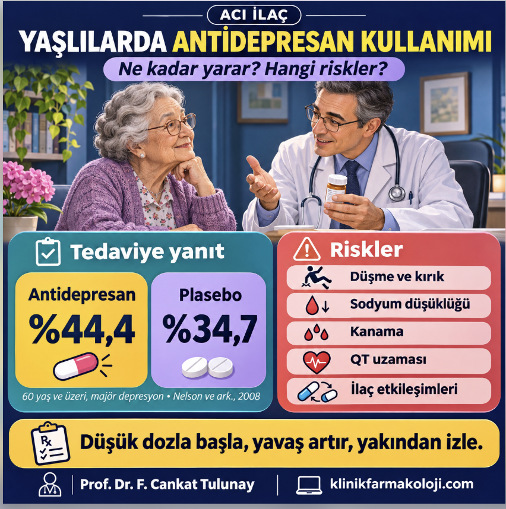

<b>Prof. Dr. F. Cankat Tulunay</b>

ABD'de hekimlere yönelik çevrim içi eğitim veren Psychopharmacology Institute, Michigan Üniversitesi'nden geriatrik psikiyatrist Dr. Lauren B. Gerlach'ın "Yaşlılarda SSRI ve SNRI kullanımı" başlıklı bir sunumunu yayımladı. Sunum kısa, derli toplu ve büyük ölçüde doğru mesajlar veriyor. Ancak yakından okununca birkaç maddi hata, bazı eksik gerekçeler ve yaşlı hastada en çok can yakan konularda belirgin boşluklar göze çarpıyor.

Bu tür özet sunumlar, pratisyen hekimden psikiyatriste kadar pek çok kişinin reçete alışkanlığını şekillendiriyor. Bu nedenle sitemizin temel ilkesini burada da uyguluyoruz: <b>değerlendirmek, doğrulamak değildir.</b> Aşağıda önce sunumun doğru söylediklerini, ardından düzeltilmesi gerekenleri ve hiç değinilmeyen ama yaşlı hasta için hayati önem taşıyan konuları ele alıyoruz.

Sunumun doğru söyledikleri

Sunumun omurgası, geriatride yıllardır tekrarlanan "düşük başla, yavaş artır, ama bırakma" ilkesi. Başlangıç dozunun genç erişkin dozunun dörtte biri ile yarısı arasında tutulması, tam etki için 8-12 hafta beklenmesi, hastanın bir iki hafta sonra "işe yaramadı" diyerek ilacı kendi başına kesmesinin önlenmesi doğru ve önemli uyarılar. Tedavide uyum konusunu daha önce "Reçete yazıldı, tedavi başladı mı?" başlıklı yazımızda ayrıntılı ele almıştık; yaşlı hastada beklenti yönetimi bunun en kritik parçasıdır.

SSRI'ların birinci basamak olarak seçilmesi, aşırı dozda trisiklik antidepresanlara göre çok daha güvenli olmaları, en sık yan etkilerin gastrointestinal yakınmalar, baş ağrısı ve cinsel işlev bozukluğu olması, yaşlıda cinsel yan etkilerin "önemsiz" sayılmaması gerektiği, sertralin, sitalopram ve essitalopramın görece az etkileşimli seçenekler olduğu, paroksetinden kaçınılması, hiponatremi ve kanama riskinin akılda tutulması, SNRI'ların kan basıncını (özellikle diyastolik basıncı) yükseltebileceği ve sabah verilmesi gerektiği de doğru mesajlar.

Benzodiazepin, hidroksizin ve gabapentin gibi "köprü" ilaçların rutin kullanılmaması önerisi ise ayrıca altı çizilmesi gereken bir nokta: yaşlıda bu ilaçlar düşme, sedasyon ve deliryum riskini artırır.

Önce asıl soru: yaşlıda antidepresan ne kadar etkili?

Sunum, antidepresanın etkinliğini veri olarak kabul edip dozlama ayrıntısına geçiyor. Oysa klinik farmakolojinin ilk sorusu "ne kadar" sorusudur. 60 yaş ve üstü majör depresyonlu hastalarda yapılan 10 plasebo kontrollü çalışmanın meta-analizinde yanıt oranı ilaç grubunda %44,4, plasebo grubunda %34,7; remisyon oranı ise %34,6'ya karşı %26,5 bulundu. Aynı ilaçlar genç erişkin çalışmalarında yaklaşık %54 yanıt veriyor; plasebo yanıtı ise iki yaş grubunda benzer. Yani yaşlıda ilacın plaseboya üstünlüğü gerçek ama mütevazıdır.

Hasta düzeyinde verilerle yapılan sonraki analiz tabloyu netleştirdi: depresyonu en az 10 yıldır süren ve en az orta şiddette (Hamilton puanı 21 ve üstü) olan hastalarda bir ek yanıt için tedavi edilmesi gereken hasta sayısı (NNT) 4 iken, öteki hastalarda bu sayı 21'e çıkıyordu. Demansla birlikte görülen depresyonda ise sertralin ve mirtazapinin plasebodan üstün olmadığı büyük bir randomize çalışmada gösterildi.

Bunun pratik anlamı şudur: "bırakma" ilkesi doğru hastada geçerlidir. Plasebo kolundaki iyileşmenin önemli bir kısmı aslında sık görüşme, izlem, bilgilendirme ve destekten kaynaklanır. Antidepresan reçete edip hastayı iki ay sonraya randevulamak, ilacın etkisini değil yalnızca riskini hastaya taşır. Sunumda tek cümleyle geçilen psikoterapi, örneğin yürütücü işlev bozukluğu olan yaşlılarda problem çözme terapisinde 12. haftada %46'ya karşı %28 remisyon sağlamıştır; ilacın yanında değil, çoğu zaman ilacın önünde düşünülmelidir.

Sitalopram, essitalopram ve QT: Atlantik'in iki yakası

Sunum, 2011'deki FDA uyarısının yalnızca sitalopramı kapsadığını, essitalopramın "işaretlenmediğini" söylüyor. Bu ABD için doğru, ama Türkiye'deki hekim için eksik ve yanıltıcı bir bilgi. Avrupa'da, sitalopram değerlendirmesinin ardından Aralık 2011'de essitalopram da ele alındı: üretici, Avrupa İlaç Ajansı ile uyumlu olarak 65 yaş üstündeki hastalarda essitalopramın en yüksek günlük dozunu 10 mg'a indirdi. Ayrıca QT uzaması bilinen ya da doğuştan uzun QT sendromu olan hastalarda ve QT aralığını uzatan başka ilaçlarla birlikte kullanım kontrendike hale getirildi.

Rakamlar şöyle: sağlıklı gönüllülerde yapılan QT çalışmasında essitalopram, plaseboya göre QTcF'yi 10 mg/gün dozda 4,3 ms, 30 mg/gün dozda 10,7 ms uzattı. Sitalopramda bu değerler 20 mg'da 7,5 ms, 60 mg'da 16,7 ms idi. İngiltere ilaç otoritesi MHRA'ya göre 65 yaş üstünde en yüksek doz sitalopram için 20 mg, essitalopram için 10 mg'dır; gerekçe, yaşla azalan metabolizma ve eliminasyon nedeniyle bu hastalarda ilaç maruziyetinin daha yüksek olmasıdır. FDA da CYP2C19 yavaş metabolizörlerde sitalopram için 20 mg sınırı koyar.

Sunumda bir de birim hatası var: konuşmacı QT'nin "12 saniye" uzamasından söz ediyor; doğrusu milisaniye. Daha önemlisi, "normal QTc'si olan hastada 10-12 ms uzama önemli değil" yaklaşımı, yaşlı hastanın gerçeğini hesaba katmıyor. Diüretik kullanan, hipokalemisi ya da hipomagnezemisi olan, aynı anda QT uzatan bir antipsikotik, makrolid, florokinolon veya antiemetik alan yaşlıda bu "küçük" artış küçük olmaktan çıkar. MHRA, özellikle diüretik veya proton pompası inhibitörü kullanan yaşlılarda serum magnezyumunun izlenmesini önerir.

Sunumdaki QTc karşılaştırma grafiği de dikkatli okunmalı: farklı çalışmalardan, farklı doz ve yöntemlerle elde edilmiş değerler (örneğin tiyoridazin 30,1 ms, ziprasidon 15,9 ms, sitalopram 10,6 ms, essitalopram 7,3 ms, sertralin 3,0 ms) yan yana konmuş. Bu bir sıralama fikri verir, ama doğrudan karşılaştırma değildir. Türkiye'de reçete yazan hekimin başvuracağı yer, ilacın Türkçe Kısa Ürün Bilgisi'ndeki (KÜB) yaşlı hasta doz sınırıdır.

Düzeltilmesi gerekenler

Aşağıdaki tabloda sunumdaki ifadeleri ve klinik farmakoloji açısından doğrularını özetliyoruz:

<table class="Table" style="border-collapse:collapse; border:solid #d0c5b3 1.0pt; width:100%">
	<tbody>
		<tr>
			<td style="border:solid #d0c5b3 1.0pt; background:#efd9dc; padding:4px 7px" valign="top">
<b><b>Sunumda söylenen</b></b>
</td>
			<td style="border:solid #d0c5b3 1.0pt; padding:4px 7px" valign="top">
<b>Doğrusu / eksik kalan</b>
</td>
		</tr>
		<tr>
			<td style="border:solid #d0c5b3 1.0pt; background:#efd9dc; padding:4px 7px" valign="top">
<b>Essitalopram FDA uyarısıyla işaretlenmedi.</b>
</td>
			<td style="border:solid #d0c5b3 1.0pt; background:#f5eee0; padding:4px 7px" valign="top">
ABD için doğru. Avrupa'da Aralık 2011'den beri 65 yaş üstünde en yüksek doz 10 mg/gün; QT uzaması bilinen hastada ve QT uzatan ilaçla birlikte kontrendike.
</td>
		</tr>
		<tr>
			<td style="border:solid #d0c5b3 1.0pt; background:#efd9dc; padding:4px 7px" valign="top">
<b>QT "12 saniye" uzarsa normal QTc'de sorun olmaz.</b>
</td>
			<td style="border:solid #d0c5b3 1.0pt; padding:4px 7px" valign="top">
Birim milisaniyedir. Üstelik yaşlıda hipokalemi, hipomagnezemi, diüretik ve öteki QT uzatıcılar bu "küçük" artışı küçük olmaktan çıkarır.
</td>
		</tr>
		<tr>
			<td style="border:solid #d0c5b3 1.0pt; background:#efd9dc; padding:4px 7px" valign="top">
<b>"Vidazolone"</b>
</td>
			<td style="border:solid #d0c5b3 1.0pt; background:#f5eee0; padding:4px 7px" valign="top">
Böyle bir ilaç yok; doğrusu vilazodon.
</td>
		</tr>
		<tr>
			<td style="border:solid #d0c5b3 1.0pt; background:#efd9dc; padding:4px 7px" valign="top">
<b>SNRI'ların hepsinin kronik ağrı endikasyonu var.</b>
</td>
			<td style="border:solid #d0c5b3 1.0pt; padding:4px 7px" valign="top">
Hayır. Ağrı endikasyonu duloksetinindir. Venlafaksin ve desvenlafaksinin ağrı endikasyonu yoktur.
</td>
		</tr>
		<tr>
			<td style="border:solid #d0c5b3 1.0pt; background:#efd9dc; padding:4px 7px" valign="top">
<b>Trombositlerde serotonin reseptörü var.</b>
</td>
			<td style="border:solid #d0c5b3 1.0pt; background:#f5eee0; padding:4px 7px" valign="top">
Kanamadaki asıl mekanizma trombositteki serotonin taşıyıcısı (SERT): SSRI trombositin serotonin depolarını boşaltır.
</td>
		</tr>
		<tr>
			<td style="border:solid #d0c5b3 1.0pt; background:#efd9dc; padding:4px 7px" valign="top">
<b>Düşme riski daha çok alfa bloke eden ilaçlarda.</b>
</td>
			<td style="border:solid #d0c5b3 1.0pt; padding:4px 7px" valign="top">
SSRI'lar ortostatik hipotansiyon olmadan da düşme ve kırıkla ilişkili; Beers 2023 düşme öyküsünde kaçınmayı önerir.
</td>
		</tr>
		<tr>
			<td style="border:solid #d0c5b3 1.0pt; background:#efd9dc; padding:4px 7px" valign="top">
<b>Paroksetinin yarı ömrü çok kısa.</b>
</td>
			<td style="border:solid #d0c5b3 1.0pt; background:#f5eee0; padding:4px 7px" valign="top">
Yarı ömrü yaklaşık 21 saat; asıl sorun aktif metabolit olmaması ve CYP2D6'yı kendi kendine inhibe eden doğrusal olmayan kinetiği.
</td>
		</tr>
		<tr>
			<td style="border:solid #d0c5b3 1.0pt; background:#efd9dc; padding:4px 7px" valign="top">
<b>Önceki bir sodyum değeri yeterli.</b>
</td>
			<td style="border:solid #d0c5b3 1.0pt; padding:4px 7px" valign="top">
Beers 2023: SSRI/SNRI başlarken ve doz değişince sodyum bakılmalı.
</td>
		</tr>
	</tbody>
</table>

Bu düzeltmelerden ikisi pratikte özellikle önemli. Birincisi ağrı endikasyonu: duloksetin diyabetik nöropatik ağrı, fibromiyalji ve kronik kas-iskelet ağrısında ruhsatlıdır; venlafaksin ve desvenlafaksinin böyle bir endikasyonu yoktur. "bir taşla iki kuş" yaklaşımı yalnızca duloksetin için geçerlidir ve duloksetinden de kreatinin klirensi 30 mL/dk altındaki hastalarda kaçınılmalıdır. İkincisi düşme: düşme ve kırık öyküsü olan yaşlıda SSRI ve SNRI başlamak, ancak daha güvenli seçenek yoksa ve düşme önleme önlemleri alınarak düşünülmelidir.

Kanama konusunda da sunumda bir pratik öneri eksik: NSAİ ilaç, aspirin veya antikoagülanla birlikte SSRI kullanan yaşlıda gastrointestinal kanamaya karşı proton pompası inhibitörü ile koruma düşünülmelidir.

Sunumda hiç olmayanlar

<b>İlaç etkileşimleri.</b> Yaşlı hastanın en büyük sorunu polifarmasidir ve sunum bu konuda yalnızca CYP2D6 inhibisyonuna değiniyor. Oysa en sık karşılaşılan tehlikeli kombinasyonlardan biri SSRI ile tramadoldür: serotonin sendromu, nöbet eşiğinin düşmesi ve ek hiponatremi riski taşır. Güçlü CYP2D6 inhibitörü olan fluoksetin ve paroksetin, kodein ve tramadolün aktif metabolitlere dönüşümünü azaltarak analjeziyi zayıflatır, metoprolol düzeylerini yükseltir, tamoksifenin etkin metaboliti endoksifenin oluşumunu engeller. Fluoksetinin aktif metaboliti norfluoksetinin yarı ömrü haftalarla ölçülür; ilaç kesildikten sonra da etkileşim sürer.

<b>Hiponatremi.</b> Sunum, "daha önce bakılmış bir sodyum değeri" görmeyi yeterli sayıyor. Beers 2023 ölçütleri ise SSRI ve SNRI başlarken ve doz değiştirilirken sodyum bakılmasını öneriyor. Risk tedavinin ilk haftalarında en yüksektir; ileri yaş, kadın cinsiyet, düşük vücut ağırlığı ve tiyazid grubu diüretik kullanımı riski artırır. Yaşlıda yeni başlayan bulanıklık, halsizlik ya da düşme, başka bir neden aranmadan önce sodyumu akla getirmelidir.

<b>Öteki seçenekler.</b> Yaşlıda sık kullanılan mirtazapin ve bupropion sunumda hiç anılmıyor. Vortioksetin ve vilazodon ise yalnızca etki mekanizmasıyla geçiliyor; yaşlıdaki kanıt düzeyleri, maliyetleri ve yerleri tartışılmıyor.

<b>Ne zaman ve nasıl bırakılacak?</b> "Bırakma" sloganı tedaviyi erken kesmemek için doğru bir uyarı, ama süresiz kullanım anlamına gelmemeli. İdame süresi, yineleme riski, kademeli azaltma ve düzenli ilaç gözden geçirmesi (deprescribing) yaşlı hastada en az başlangıç dozu kadar önemlidir. Paroksetin ve venlafaksin gibi kesilme belirtileri belirgin ilaçlarda azaltma yavaş yapılmalıdır.

<b>Pratik doz notu.</b> Essitalopram için önerilen 2,5 mg başlangıç dozu, tablet bölmeyi ya da her ülkede bulunmayan damla formunu gerektirir. Sunumdaki bu öneri, ilacın piyasadaki formlarına bakılarak uygulanmalıdır.

Sonuç

Gerlach'ın sunumu, yaşlı hastada antidepresan kullanımına iyi bir giriş; ama tek başına reçete rehberi olarak kullanılmamalı. Sunumdaki maddi hatalar küçük görünebilir; ancak "bütün SNRI'lar ağrıda ruhsatlı" ya da "essitalopramın QT uyarısı yok" gibi cümleler, yaşlı hastada gereksiz ilaç maruziyetine ve sınırların üstünde dozlara kapı açar.

Türkiye'de reçete yazan hekim için kontrol listesi kısadır: ilacın KÜB'ündeki yaşlı hasta doz sınırına bakmak; Beers ölçütlerini gözden geçirmek; hastanın tüm ilaçlarını etkileşim açısından taramak; başlangıçta ve doz değişiminde sodyum, gerektiğinde EKG ve elektrolit izlemek; hastayı ilk haftalarda sık görmek ve ilacın yanında psikososyal desteği planlamak. Kendi pratiğimize de dürüstçe bakalım: 65 yaş üstündeki hastaya essitalopram 20 mg ya da sitalopram 40 mg reçete ediliyorsa, bu bir Acı İlaç'tır.

Kaynaklar

<ol style="margin:0 0 6px; padding-left:24px; font-size:9.5pt; line-height:1.3">
	<li style="margin:0 0 1px; padding:0; font-family:Georgia,serif; font-size:9.5pt; line-height:1.3; font-style:italic; color:#333; overflow-wrap:anywhere">Gerlach LB. Using SSRIs and SNRIs in the Geriatric Population [eğitim sunumu]. Psychopharmacology Institute.</li>
	<li style="margin:0 0 1px; padding:0; font-family:Georgia,serif; font-size:9.5pt; line-height:1.3; font-style:italic; color:#333; overflow-wrap:anywhere">Nelson JC, Delucchi K, Schneider LS. Efficacy of second generation antidepressants in late-life depression: a meta-analysis of the evidence. Am J Geriatr Psychiatry. 2008;16:558-67.</li>
	<li style="margin:0 0 1px; padding:0; font-family:Georgia,serif; font-size:9.5pt; line-height:1.3; font-style:italic; color:#333; overflow-wrap:anywhere">Tedeschini E, Levkovitz Y, Iovieno N, et al. Efficacy of antidepressants for late-life depression: a meta-analysis and meta-regression of placebo-controlled randomized trials. J Clin Psychiatry. 2011;72:1660-8.</li>
	<li style="margin:0 0 1px; padding:0; font-family:Georgia,serif; font-size:9.5pt; line-height:1.3; font-style:italic; color:#333; overflow-wrap:anywhere">Nelson JC, Delucchi KL, Schneider LS. Moderators of outcome in late-life depression: a patient-level meta-analysis. Am J Psychiatry. 2013;170:651-9.</li>
	<li style="margin:0 0 1px; padding:0; font-family:Georgia,serif; font-size:9.5pt; line-height:1.3; font-style:italic; color:#333; overflow-wrap:anywhere">Banerjee S, Hellier J, Dewey M, et al. Sertraline or mirtazapine for depression in dementia (HTA-SADD). Lancet. 2011;378:403-11.</li>
	<li style="margin:0 0 1px; padding:0; font-family:Georgia,serif; font-size:9.5pt; line-height:1.3; font-style:italic; color:#333; overflow-wrap:anywhere">Areán PA, Raue P, Mackin RS, et al. Problem-solving therapy and supportive therapy in older adults with major depression and executive dysfunction. Am J Psychiatry. 2010;167:1391-8.</li>
	<li style="margin:0 0 1px; padding:0; font-family:Georgia,serif; font-size:9.5pt; line-height:1.3; font-style:italic; color:#333; overflow-wrap:anywhere">MHRA. Citalopram and escitalopram: QT interval prolongation. Drug Safety Update. 2011;5(5):A1.</li>
	<li style="margin:0 0 1px; padding:0; font-family:Georgia,serif; font-size:9.5pt; line-height:1.3; font-style:italic; color:#333; overflow-wrap:anywhere">AEMPS. Escitalopram: prolongación del intervalo QT del electrocardiograma. Nota informativa MUH (FV) 23/2011, 2 Aralık 2011.</li>
	<li style="margin:0 0 1px; padding:0; font-family:Georgia,serif; font-size:9.5pt; line-height:1.3; font-style:italic; color:#333; overflow-wrap:anywhere">FDA. Drug Safety Communication: Abnormal heart rhythms associated with high doses of Celexa (citalopram hydrobromide). 24 Ağustos 2011.</li>
	<li style="margin:0 0 1px; padding:0; font-family:Georgia,serif; font-size:9.5pt; line-height:1.3; font-style:italic; color:#333; overflow-wrap:anywhere">Beach SR, Kostis WJ, Celano CM, et al. Meta-analysis of selective serotonin reuptake inhibitor-associated QTc prolongation. J Clin Psychiatry. 2014;75(5):e441-9.</li>
	<li style="margin:0 0 1px; padding:0; font-family:Georgia,serif; font-size:9.5pt; line-height:1.3; font-style:italic; color:#333; overflow-wrap:anywhere">2023 American Geriatrics Society Beers Criteria Update Expert Panel. American Geriatrics Society 2023 updated AGS Beers Criteria. J Am Geriatr Soc. 2023;71:2052-81.</li>
	<li style="margin:0 0 1px; padding:0; font-family:Georgia,serif; font-size:9.5pt; line-height:1.3; font-style:italic; color:#333; overflow-wrap:anywhere">Gheysens T, Van Den Eede F, De Picker L. The risk of antidepressant-induced hyponatremia: a meta-analysis. Eur Psychiatry. 2024;67(1):e20.</li>
	<li style="margin:0 0 1px; padding:0; font-family:Georgia,serif; font-size:9.5pt; line-height:1.3; font-style:italic; color:#333; overflow-wrap:anywhere">Edinoff AN, Raveendran K, Colon MA, et al. Selective serotonin reuptake inhibitors and associated bleeding risks: a narrative and clinical review. Health Psychol Res. 2022;10(4):39580.</li>
</ol>

Not: Bu yazının hazırlanmasında AI desteği alınmıştır.

