
2023–2026 arasında FDA onayı alan ve klinik/preklinik aşamada olan 13 antibakteriyelin klinik farmakolojik değerlendirmesi

Basında her yeni antibiyotik onayı “süper bakterilere karşı devrim” başlığıyla duyuruluyor. Oysa “yeni antibiyotik” tek bir kategori değildir. Son üç yılda ruhsat alan ilaçların çoğu, onlarca yıldır kullanılan beta-laktamların yeni bir beta-laktamaz inhibitörüyle birleştirilmesinden, eski bir molekülün ABD'de ilk kez ruhsatlandırılmasından ya da var olan bir sınıfın ağızdan alınabilen biçiminden oluşuyor. Gerçekten yeni bir bakteriyel hedefe yönelen moleküllerin sayısı ise bir elin parmaklarını geçmiyor ve bunların önemli bir kısmı henüz hastada denenmedi.

Bu yazıda 13 molekülü dört grupta ele alıyoruz: yeni kimyasal sınıftan olup klinikte kullanılanlar, mevcut sınıfları güçlendiren kombinasyonlar, oral uygulama yenilikleri ve araştırma aşamasındaki adaylar. Her ilaç için ruhsatlı endikasyon, etki mekanizması, onayı destekleyen ana klinik araştırmanın sayısal sonuçları, doz ve güvenlilik bilgileri birincil kaynaklardan (FDA kararları, ürün bilgileri, hakemli yayınlar) aktarılmıştır. Her bölümdeki renkli şema, mekanizmanın kavramsal gösterimidir; moleküler yapının gerçek çizimi değildir.

<table class="Table" style="border-collapse:collapse; width:100%; margin:10px 0 6px"><tbody><tr><td style="border-left:solid #7a1f2b 4.0pt; background:#f5eee0; padding:8px 12px" valign="top">
Kanıtı okurken

<b>FDA onaylı</b> ifadesi, ilacın yalnızca belirli bir enfeksiyon ve hasta grubu için ruhsatlandığını gösterir; ruhsat dışı endikasyonlarda etkinlik kanıtlanmış sayılmaz.

<b>Aşağı kalmama (non-inferiority)</b> sonucu üstünlük anlamına gelmez; yeni ilacın karşılaştırıcıdan önceden belirlenmiş bir sınırdan daha kötü olmadığını gösterir.

<b>In vitro duyarlılık</b> ya da düşük MIC değerleri, sağkalım yararı anlamına gelmez. MIC50/MIC90 ancak tür, izolat sayısı, direnç genotipi ve test yöntemiyle birlikte anlamlıdır; tek bir “evrensel MIC” yazmak yanıltıcıdır. Duyarlılık yorumu, FDA'nın türe özgü sınır değerlerine göre yapılmalıdır.

<b>Preklinik</b> moleküller için insanda etkinlik, doz ve güvenlilik verisi yoktur; laboratuvar başarısı klinik başarının habercisi değildir.
</td></tr></tbody></table>

Bir bakışta 13 molekül

<table class="Table" style="border-collapse:collapse; border:solid #d0c5b3 1.0pt; width:100%"><tbody><tr><td style="border:solid #d0c5b3 1.0pt; padding:4px 7px; background:#7a1f2b" valign="top">
<b>İlaç (ticari ad)</b>
</td><td style="border:solid #d0c5b3 1.0pt; padding:4px 7px; background:#7a1f2b" valign="top">
<b>Yenilik türü</b>
</td><td style="border:solid #d0c5b3 1.0pt; padding:4px 7px; background:#7a1f2b" valign="top">
<b>Yol</b>
</td><td style="border:solid #d0c5b3 1.0pt; padding:4px 7px; background:#7a1f2b" valign="top">
<b>Durum</b>
</td><td style="border:solid #d0c5b3 1.0pt; padding:4px 7px; background:#7a1f2b" valign="top">
<b>Ana klinik kanıt</b>
</td></tr><tr><td style="border:solid #d0c5b3 1.0pt; padding:4px 7px" valign="top">
<b>Gepotidasin (Blujepa)</b>
</td><td style="border:solid #d0c5b3 1.0pt; padding:4px 7px" valign="top">
Yeni sınıf: triazaasenaftilen
</td><td style="border:solid #d0c5b3 1.0pt; padding:4px 7px" valign="top">
Oral
</td><td style="border:solid #d0c5b3 1.0pt; padding:4px 7px" valign="top">
FDA, Mart 2025
</td><td style="border:solid #d0c5b3 1.0pt; padding:4px 7px" valign="top">
EAGLE-2/3: nitrofurantoine karşı
</td></tr><tr><td style="border:solid #d0c5b3 1.0pt; padding:4px 7px; background:#f5eee0" valign="top">
<b>Zoliflodasin (Nuzolvence)</b>
</td><td style="border:solid #d0c5b3 1.0pt; padding:4px 7px; background:#f5eee0" valign="top">
Yeni sınıf: spiropirimidinetrion
</td><td style="border:solid #d0c5b3 1.0pt; padding:4px 7px; background:#f5eee0" valign="top">
Oral, tek doz
</td><td style="border:solid #d0c5b3 1.0pt; padding:4px 7px; background:#f5eee0" valign="top">
FDA, Aralık 2025
</td><td style="border:solid #d0c5b3 1.0pt; padding:4px 7px; background:#f5eee0" valign="top">
Seftriakson+azitromisine karşı, n=930
</td></tr><tr><td style="border:solid #d0c5b3 1.0pt; padding:4px 7px" valign="top">
<b>Sefepim–zidebaktam (Zaynich)</b>
</td><td style="border:solid #d0c5b3 1.0pt; padding:4px 7px" valign="top">
Kombinasyon (PBP2 hedefli ortak)
</td><td style="border:solid #d0c5b3 1.0pt; padding:4px 7px" valign="top">
IV
</td><td style="border:solid #d0c5b3 1.0pt; padding:4px 7px" valign="top">
FDA, Mayıs 2026
</td><td style="border:solid #d0c5b3 1.0pt; padding:4px 7px" valign="top">
ENHANCE-1: meropeneme karşı, n=530
</td></tr><tr><td style="border:solid #d0c5b3 1.0pt; padding:4px 7px; background:#f5eee0" valign="top">
<b>Sefepim–enmetazobaktam (Exblifep)</b>
</td><td style="border:solid #d0c5b3 1.0pt; padding:4px 7px; background:#f5eee0" valign="top">
Kombinasyon (ESBL inhibitörü)
</td><td style="border:solid #d0c5b3 1.0pt; padding:4px 7px; background:#f5eee0" valign="top">
IV
</td><td style="border:solid #d0c5b3 1.0pt; padding:4px 7px; background:#f5eee0" valign="top">
FDA, Şubat 2024
</td><td style="border:solid #d0c5b3 1.0pt; padding:4px 7px; background:#f5eee0" valign="top">
ALLIUM: piperasilin-tazobaktama karşı
</td></tr><tr><td style="border:solid #d0c5b3 1.0pt; padding:4px 7px" valign="top">
<b>Sulbaktam–durlobaktam (Xacduro)</b>
</td><td style="border:solid #d0c5b3 1.0pt; padding:4px 7px" valign="top">
Kombinasyon (Acinetobacter'e özgü)
</td><td style="border:solid #d0c5b3 1.0pt; padding:4px 7px" valign="top">
IV
</td><td style="border:solid #d0c5b3 1.0pt; padding:4px 7px" valign="top">
FDA, Mayıs 2023
</td><td style="border:solid #d0c5b3 1.0pt; padding:4px 7px" valign="top">
ATTACK: kolistine karşı, n=181
</td></tr><tr><td style="border:solid #d0c5b3 1.0pt; padding:4px 7px; background:#f5eee0" valign="top">
<b>Aztreonam–avibaktam (Emblaveo)</b>
</td><td style="border:solid #d0c5b3 1.0pt; padding:4px 7px; background:#f5eee0" valign="top">
Kombinasyon (MBL üreticilerine)
</td><td style="border:solid #d0c5b3 1.0pt; padding:4px 7px; background:#f5eee0" valign="top">
IV
</td><td style="border:solid #d0c5b3 1.0pt; padding:4px 7px; background:#f5eee0" valign="top">
FDA, Şubat 2025
</td><td style="border:solid #d0c5b3 1.0pt; padding:4px 7px; background:#f5eee0" valign="top">
REVISIT: meropeneme karşı
</td></tr><tr><td style="border:solid #d0c5b3 1.0pt; padding:4px 7px" valign="top">
<b>Seftobiprol (Zevtera)</b>
</td><td style="border:solid #d0c5b3 1.0pt; padding:4px 7px" valign="top">
Eski molekül, yeni ABD ruhsatı
</td><td style="border:solid #d0c5b3 1.0pt; padding:4px 7px" valign="top">
IV
</td><td style="border:solid #d0c5b3 1.0pt; padding:4px 7px" valign="top">
FDA, Nisan 2024
</td><td style="border:solid #d0c5b3 1.0pt; padding:4px 7px" valign="top">
ERADICATE: daptomisine karşı
</td></tr><tr><td style="border:solid #d0c5b3 1.0pt; padding:4px 7px; background:#f5eee0" valign="top">
<b>Tebipenem pivoksil (Utebzi)</b>
</td><td style="border:solid #d0c5b3 1.0pt; padding:4px 7px; background:#f5eee0" valign="top">
İlk oral karbapenem
</td><td style="border:solid #d0c5b3 1.0pt; padding:4px 7px; background:#f5eee0" valign="top">
Oral
</td><td style="border:solid #d0c5b3 1.0pt; padding:4px 7px; background:#f5eee0" valign="top">
FDA, Haziran 2026
</td><td style="border:solid #d0c5b3 1.0pt; padding:4px 7px; background:#f5eee0" valign="top">
PIVOT-PO: imipeneme karşı, n=1.690
</td></tr><tr><td style="border:solid #d0c5b3 1.0pt; padding:4px 7px" valign="top">
<b>Sulopenem–probenesid (Orlynvah)</b>
</td><td style="border:solid #d0c5b3 1.0pt; padding:4px 7px" valign="top">
Oral penem
</td><td style="border:solid #d0c5b3 1.0pt; padding:4px 7px" valign="top">
Oral
</td><td style="border:solid #d0c5b3 1.0pt; padding:4px 7px" valign="top">
FDA, Ekim 2024
</td><td style="border:solid #d0c5b3 1.0pt; padding:4px 7px" valign="top">
REASSURE: amoksisilin-klavulanata karşı
</td></tr><tr><td style="border:solid #d0c5b3 1.0pt; padding:4px 7px; background:#f5eee0" valign="top">
<b>Pivmesilinam (Pivya)</b>
</td><td style="border:solid #d0c5b3 1.0pt; padding:4px 7px; background:#f5eee0" valign="top">
Eski molekül, yeni ABD ruhsatı
</td><td style="border:solid #d0c5b3 1.0pt; padding:4px 7px; background:#f5eee0" valign="top">
Oral
</td><td style="border:solid #d0c5b3 1.0pt; padding:4px 7px; background:#f5eee0" valign="top">
FDA, Nisan 2024
</td><td style="border:solid #d0c5b3 1.0pt; padding:4px 7px; background:#f5eee0" valign="top">
Üç eski kontrollü çalışma
</td></tr><tr><td style="border:solid #d0c5b3 1.0pt; padding:4px 7px" valign="top">
<b>Zosurabalpin (RG6006)</b>
</td><td style="border:solid #d0c5b3 1.0pt; padding:4px 7px" valign="top">
Yeni hedef: LPS taşıma kompleksi
</td><td style="border:solid #d0c5b3 1.0pt; padding:4px 7px" valign="top">
IV
</td><td style="border:solid #d0c5b3 1.0pt; padding:4px 7px" valign="top">
Faz III
</td><td style="border:solid #d0c5b3 1.0pt; padding:4px 7px" valign="top">
Faz I tamamlandı
</td></tr><tr><td style="border:solid #d0c5b3 1.0pt; padding:4px 7px; background:#f5eee0" valign="top">
<b>Manikomisin</b>
</td><td style="border:solid #d0c5b3 1.0pt; padding:4px 7px; background:#f5eee0" valign="top">
Yeni hedef: ribozom E bölgesi
</td><td style="border:solid #d0c5b3 1.0pt; padding:4px 7px; background:#f5eee0" valign="top">
–
</td><td style="border:solid #d0c5b3 1.0pt; padding:4px 7px; background:#f5eee0" valign="top">
Preklinik
</td><td style="border:solid #d0c5b3 1.0pt; padding:4px 7px; background:#f5eee0" valign="top">
Yok (laboratuvar ve yapı verisi)
</td></tr><tr><td style="border:solid #d0c5b3 1.0pt; padding:4px 7px" valign="top">
<b>Pre-metilenomisin C lakton</b>
</td><td style="border:solid #d0c5b3 1.0pt; padding:4px 7px" valign="top">
Doğal ürün ara maddesi
</td><td style="border:solid #d0c5b3 1.0pt; padding:4px 7px" valign="top">
–
</td><td style="border:solid #d0c5b3 1.0pt; padding:4px 7px" valign="top">
Preklinik
</td><td style="border:solid #d0c5b3 1.0pt; padding:4px 7px" valign="top">
Yok (in vitro veri)
</td></tr></tbody></table>

A. Yeni kimyasal sınıftan olup klinikte kullanılanlar

1. Gepotidasin (Blujepa)

FDA onayı: 25 Mart 2025 · Oral · Triazaasenaftilen sınıfı topoizomeraz inhibitörü

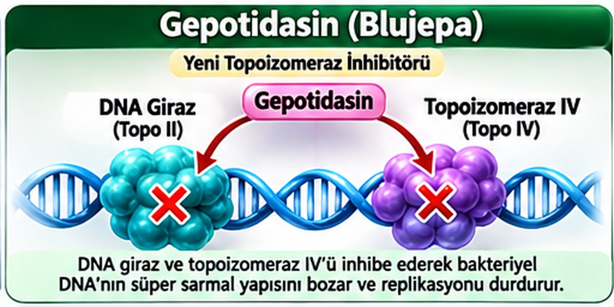

<b>Şekil 1.</b> Gepotidasin: DNA giraz ve topoizomeraz IV'ün birlikte inhibisyonu (kavramsal şema).

<b>Endikasyon:</b> Erişkin ve 12 yaş üstü kadınlarda komplike olmayan idrar yolu enfeksiyonu; ayrıca seçilmiş hastalarda komplike olmayan ürogenital gonore.

<b>Mekanizma ve farkı:</b> DNA giraz ve topoizomeraz IV'ü inhibe eder. Hedef enzimler florokinolonlarla aynı olsa da bağlanma bölgesi ve etkileşim biçimi farklıdır; bu nedenle florokinolon direncinin bir kısmından etkilenmez. Ancak mekanizmanın yeni olması, çapraz ya da edinilmiş direnç riskini ortadan kaldırmaz.

<b>Klinik kanıt:</b> İki faz III çalışmada (EAGLE-2 ve EAGLE-3) birleşik klinik ve mikrobiyolojik yanıt: birinci çalışmada gepotidasin %51,8 (174/336), nitrofurantoin %47,0 (140/298); ikinci çalışmada %58,9 (172/292) ve %44,0 (121/275). İkinci çalışmada mutlak fark %14,4 (%95 GA %6,4–22,4). Farengeal veya dissemine gonore için aynı sonuç varsayılamaz.

<b>Güvenlilik:</b> Birleşik güvenlilik popülasyonunda ishal %16 (258/1.570), bulantı %9, karın ağrısı %4, gaz %3, baş ağrısı %2, baş dönmesi %2. Nitrofurantoin kolunda ishal %3'tür. QT uzaması ve ilaç etkileşimleri açısından ürün bilgisi kontrol edilmelidir.

<b>Yorum:</b> Uzun aradan sonra idrar yolu enfeksiyonu için gelen ilk yeni sınıf oral antibiyotik. Ancak gastrointestinal yan etki yükü nitrofurantoine göre belirgin biçimde fazladır; basit sistitte ilk tercih değil, direnç durumunda seçenek olarak düşünülmelidir.

2. Zoliflodasin (Nuzolvence)

FDA onayı: 12 Aralık 2025 · Oral tek doz granül · Spiropirimidinetrion sınıfı

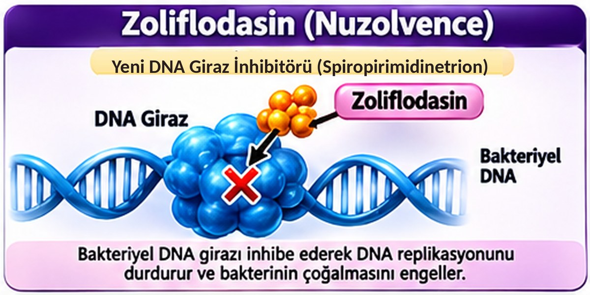

<b>Şekil 2.</b> Zoliflodasin: bakteriyel DNA girazının yeni bir bölgeden inhibisyonu (kavramsal şema).

<b>Endikasyon:</b> Komplike olmayan ürogenital gonore; 12 yaş üstü ve en az 35 kg ağırlığındaki hastalar.

<b>Mekanizma ve farkı:</b> DNA girazını florokinolonlardan farklı bir bölgeden inhibe eder. Gonorede ağızdan tek doz verilebilen ilk yeni sınıf ilaçtır.

<b>Klinik kanıt:</b> Faz III çalışmaya 930 kişi alındı; etkinlik kültür negatifleşmesiyle değerlendirildi. Ürogenital mikrobiyolojik kür zoliflodasinle %90,9 (460/506), seftriakson–azitromisin kolunda %96,2 (229/238); mutlak fark −%5,3 (%95 GA −%8,7 ila −%1,4). Bu sonuç, zoliflodasinin karşılaştırıcıdan daha iyi olduğunu göstermez; aşağı kalmama sınırı içinde ama sayısal olarak daha düşük bir kür oranıdır. Ürogenital kür, farengeal ya da yaygın gonoreye otomatik olarak aktarılamaz.

<b>Güvenlilik:</b> Baş ağrısı %10 (61/619), baş dönmesi %3, bulantı %3, ishal %2. Laboratuvar ölçümlerinde nötropeni %12 (71/609). Hayvan üreme toksisitesi bulguları nedeniyle gebelik ve kontrasepsiyon uyarıları önemlidir.

<b>Yorum:</b> Asıl değeri, enjeksiyon gerektirmeyen tek doz bir alternatif olması ve seftriakson direncine karşı yedek seçenek sunmasıdır. Ekstragenital enfeksiyonlarda ve direnç gelişiminde izlem şarttır.

B. Mevcut sınıfları güçlendiren kombinasyonlar

3. Sefepim–zidebaktam (Zaynich)

FDA onayı: 29 Mayıs 2026 · İntravenöz · Sefepim + beta-laktam güçlendirici (zidebaktam)

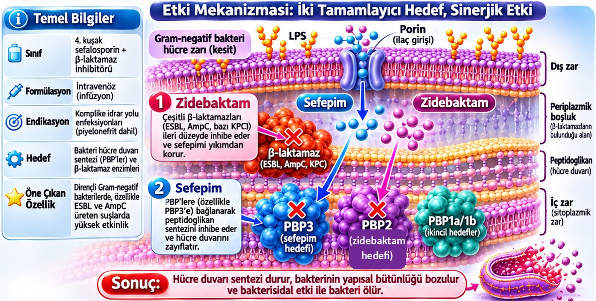

<b>Şekil 3.</b> Sefepim–zidebaktam: sefepim PBP3'e, zidebaktam PBP2'ye bağlanır; zidebaktam ayrıca bazı beta-laktamazları inhibe eder (kavramsal şema).

<b>Endikasyon:</b> Erişkinlerde, duyarlı Gram-negatif etkenlerin (E. coli, K. pneumoniae, P. mirabilis, Enterobacter cloacae kompleksi, P. aeruginosa) neden olduğu, piyelonefrit dahil komplike idrar yolu enfeksiyonları.

<b>Mekanizma ve farkı:</b> Zidebaktam yalnızca bir enzim inhibitörü değildir; doğrudan PBP2'ye bağlanan bir antibakteriyel bileşendir ve sınıf A/C beta-laktamazları da inhibe eder. Sefepim ağırlıklı olarak PBP3'ü hedefler. Birden fazla PBP'nin aynı anda bağlanması, bazı enzimatik olmayan direnç mekanizmalarına (dışa atım pompası, porin kaybı) karşı da avantaj sağlayabilir.

<b>Klinik kanıt:</b> ENHANCE-1 (NCT04979806) faz III, çift kör çalışmasında 530 erişkin 2:1 oranında randomize edildi (352 sefepim–zidebaktam, 177 meropenem). Test-of-cure ziyaretinde birleşik klinik ve mikrobiyolojik yanıt %89,0'a karşı %68,4 bulundu ve üstünlük bildirildi. Ancak çalışma, meropeneme dirençli başlangıç izolatlarını birincil analizden dışladı; bu nedenle sonuçları karbapenem dirençli tüm izolatlara genellemek doğru değildir.

<b>Farmakokinetik ve doz:</b> 2 g/1 g intravenöz, 1 saatlik infüzyonla 8 saatte bir; böbrek işlevine göre doz ayarı. Böbrek işlevi normal alt grupta (n=99) kararlı durumda sefepim Cmax 125 µg/mL, AUC0–24 1.070 µg·saat/mL; zidebaktam Cmax 61 µg/mL, AUC0–24 544 µg·saat/mL.

<b>Güvenlilik:</b> En sık bildirilen advers reaksiyonlar arasında ishal, hipertansiyon ve baş ağrısı yer alır. Sefepime bağlı nörotoksisite (ensefalopati, nöbet) özellikle böbrek yetmezliğinde ve uygunsuz dozda kritik risktir.

<b>Yorum:</b> Üretici Wockhardt'a göre, bir Hint ilaç şirketinin baştan sona geliştirip FDA onayı aldığı ilk yeni kimyasal antitedir. Klinik kanıt şimdilik idrar yolu enfeksiyonuyla sınırlıdır; dirençli Pseudomonas ve karbapenemazlı izolatlardaki in vitro sonuçlar, pnömoni veya bakteriyemi için kanıt yerine geçmez.

4. Sefepim–enmetazobaktam (Exblifep)

FDA onayı: 22 Şubat 2024 · İntravenöz · Sefepim + ESBL inhibitörü

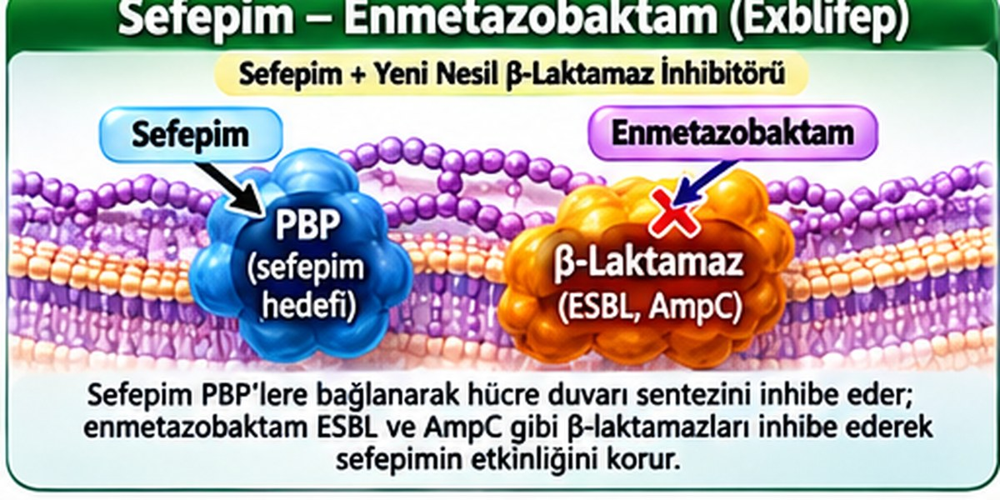

<b>Şekil 4.</b> Sefepim–enmetazobaktam: enmetazobaktam ESBL tipi beta-laktamazları inhibe ederek sefepimi korur (kavramsal şema).

<b>Endikasyon:</b> 18 yaş ve üzeri hastalarda, duyarlı Gram-negatiflerin neden olduğu, piyelonefrit dahil komplike idrar yolu enfeksiyonları.

<b>Mekanizma ve farkı:</b> Enmetazobaktam, tazobaktam yapısına benzeyen ve özellikle ESBL tipi (sınıf A) enzimleri inhibe eden bir penisilanik asit sülfonudur. Amaç, ESBL üreten bakterilerde karbapenem kullanımını azaltmaktır. KPC, OXA-48 ve metallo-beta-laktamaz gibi karbapenemazlara karşı güvenilir bir çözüm değildir.

<b>Klinik kanıt:</b> ALLIUM faz III çalışmasında 1.041 hasta randomize edildi. Birincil analiz setinde birleşik klinik kür ve mikrobiyolojik eradikasyon sefepim–enmetazobaktamla %79,1 (273/345), piperasilin–tazobaktamla %58,9 (196/333); fark %21,2 (%95 GA %14,3–27,9). Sonuç hem aşağı kalmama hem de önceden tanımlı üstünlük ölçütünü karşıladı.

<b>Doz ve güvenlilik:</b> 2 g/0,5 g intravenöz, 2 saatlik infüzyonla 8 saatte bir, 7 gün (bakteriyemide 14 güne kadar). Böbrek işlevine göre doz ayarı gerekir; sefepim nörotoksisitesi burada da önemlidir.

<b>Yorum:</b> Piperasilin–tazobaktama karşı belirgin üstünlük, karşılaştırıcının ESBL'li olgulardaki zayıflığını da yansıtır. Klinik kanıt yalnızca idrar yolu enfeksiyonundan gelir.

5. Sulbaktam–durlobaktam (Xacduro)

FDA onayı: Mayıs 2023 · İntravenöz · Acinetobacter'e yönelik beta-laktam/beta-laktamaz inhibitörü

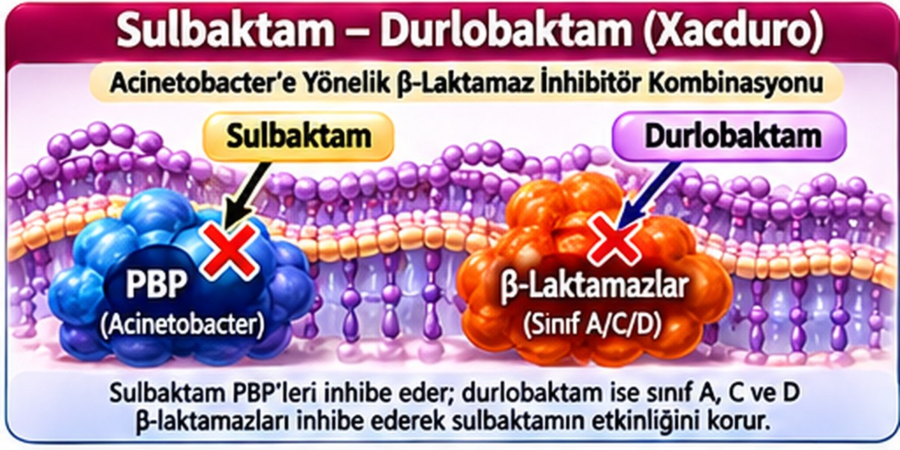

<b>Şekil 5.</b> Sulbaktam–durlobaktam: sulbaktam Acinetobacter PBP'lerine bağlanır; durlobaktam sınıf A, C ve D beta-laktamazları inhibe eder (kavramsal şema).

<b>Endikasyon:</b> Duyarlı Acinetobacter baumannii–calcoaceticus kompleksinin neden olduğu hastane kökenli ve ventilatör ilişkili bakteriyel pnömoni.

<b>Mekanizma ve farkı:</b> Sulbaktam, Acinetobacter'e karşı kendi başına antibakteriyel etkisi olan bir beta-laktamaz inhibitörüdür. Durlobaktam, OXA tipi karbapenemazlar dahil sınıf A, C ve D enzimlerini inhibe ederek sulbaktamı korur. ATTACK izolatlarında durlobaktam, sulbaktama duyarsız izolatların %95,2'sinde (159/167) sulbaktam etkinliğini geri kazandırdı. Metallo-beta-laktamazlara etkili değildir.

<b>Klinik kanıt:</b> ATTACK faz III çalışmasında 181 hasta, arka plan tedavisi olarak imipenem–silastatin alırken sulbaktam–durlobaktam ya da kolistine randomize edildi. Karbapenem dirençli olgularda 28. gün tüm nedenlere bağlı mortalite sulbaktam–durlobaktamla %19 (12/63), kolistinle %32 (20/62); fark −%13,2 (%95 GA −30,0 ila 3,5). Önceden belirlenen aşağı kalmama ölçütü karşılandı; çalışma üstünlüğü kanıtlayacak büyüklükte değildi.

<b>Güvenlilik:</b> Nefrotoksisite sulbaktam–durlobaktamla %13 (12/91), kolistinle %38 (32/85) (p&lt;0,001). Ciddi advers olay %40'a karşı %49.

<b>Doz:</b> 1 g sulbaktam + 1 g durlobaktam, 3 saatlik infüzyonla 6 saatte bir; böbrek işlevine göre ayarlanır.

<b>Yorum:</b> Tek bir patojene odaklı, dar ama değerli bir ilaç; geniş spektrumlu yeni bir antibiyotik değildir. Asıl kazanç, kolistinin böbrek toksisitesinden kaçınmaktır.

6. Aztreonam–avibaktam (Emblaveo)

FDA onayı: 7 Şubat 2025 · İntravenöz · Monobaktam + beta-laktamaz inhibitörü

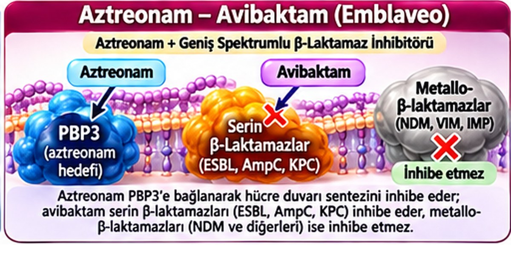

<b>Şekil 6.</b> Aztreonam–avibaktam: aztreonam PBP3'e bağlanır; avibaktam serin beta-laktamazları inhibe eder, metallo-beta-laktamazları inhibe etmez (kavramsal şema).

<b>Endikasyon:</b> Metronidazolle birlikte, sınırlı ya da hiç tedavi seçeneği olmayan 18 yaş ve üzeri hastalarda komplike intraabdominal enfeksiyonlar.

<b>Mekanizma ve farkı:</b> Aztreonam metallo-beta-laktamazlar (NDM, VIM, IMP) tarafından yıkılmaz; ancak bu bakterilerin çoğu aynı anda ESBL, AmpC veya KPC de taşır. Avibaktam bu serin enzimleri inhibe ederek aztreonamı korur. Böylece MBL üreten Enterobacterales için mekanistik olarak akılcı bir kombinasyon ortaya çıkar. Duyarlılık testi şarttır.

<b>Klinik kanıt:</b> REVISIT çalışmasında komplike intraabdominal enfeksiyonlu 312 hasta 2:1 oranında aztreonam–avibaktam + metronidazol ya da meropenem ± kolistine randomize edildi. Klinik kür %76,4'e karşı %74,0 bulundu. Çalışma karşılaştırıcıya karşı resmî hipotez testi için tasarlanmamıştı ve FDA onayı “sınırlı klinik veri” temelinde verildi.

<b>Yorum:</b> Daha önce aztreonam ile seftazidim–avibaktamın ayrı ayrı birlikte verildiği tedavinin sabit dozlu biçimidir. MBL'li enfeksiyonlarda önemli bir boşluğu doldurur, ancak kanıt düzeyi zayıftır.

7. Seftobiprol medokaril (Zevtera)

FDA onayı: 3 Nisan 2024 · İntravenöz · MRSA'ya etkili sefalosporin

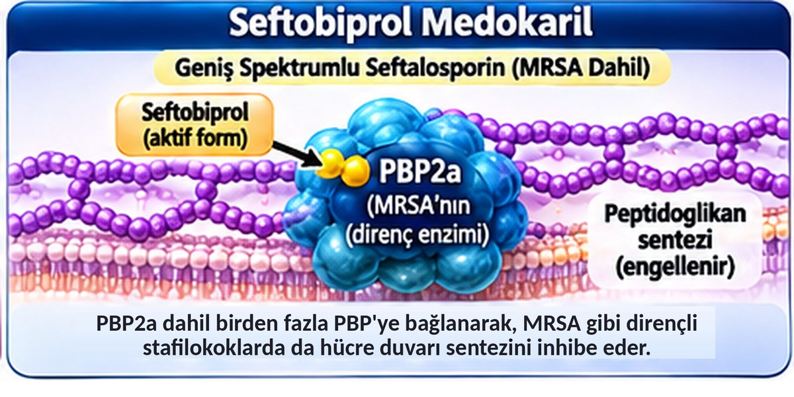

<b>Şekil 7.</b> Seftobiprol: MRSA'nın direnç enzimi PBP2a dahil birden fazla PBP'ye bağlanır (kavramsal şema).

<b>Endikasyon:</b> Sağ kalp endokarditi dahil Staphylococcus aureus bakteriyemisi, akut bakteriyel deri ve yumuşak doku enfeksiyonları ve toplum kökenli bakteriyel pnömoni.

<b>Mekanizma ve farkı:</b> PBP2a'ya bağlanabilen, Gram-pozitif ve bazı Gram-negatiflere etkili bir sefalosporindir. Avrupa'da yıllardır kullanılmaktadır; ABD için yeni olan ruhsattır. Dirençli Gram-negatiflerin çoğuna etkili değildir.

<b>Klinik kanıt:</b> ERADICATE faz III, çift kör çalışmasında komplike S. aureus bakteriyemisi olan 387 hastada 70. gün genel tedavi başarısı seftobiprolle %69,8 (132/189), daptomisinle %68,7 (136/198); düzeltilmiş fark %2,0 (%95 GA −7,1 ila 11,1). Mortalite %9,0'a karşı %9,1. Sonuç aşağı kalmamadır, üstünlük değildir.

<b>Doz ve güvenlilik:</b> Bakteriyemide 500 mg intravenöz, ilk 8 gün 6 saatte bir, sonra 8 saatte bir; böbrek işlevine göre ayarlanır. Gastrointestinal advers olaylar (özellikle hafif bulantı) daptomisine göre daha sıktır.

<b>Yorum:</b> MRSA bakteriyemisinde vankomisin ve daptomisine bir beta-laktam alternatifi sunması klinik açıdan değerlidir. Ancak yeni bir molekül değildir.

C. Oral uygulama yenilikleri

8. Tebipenem pivoksil (Utebzi)

FDA onayı: 17 Haziran 2026 · Oral · Karbapenem ön ilacı

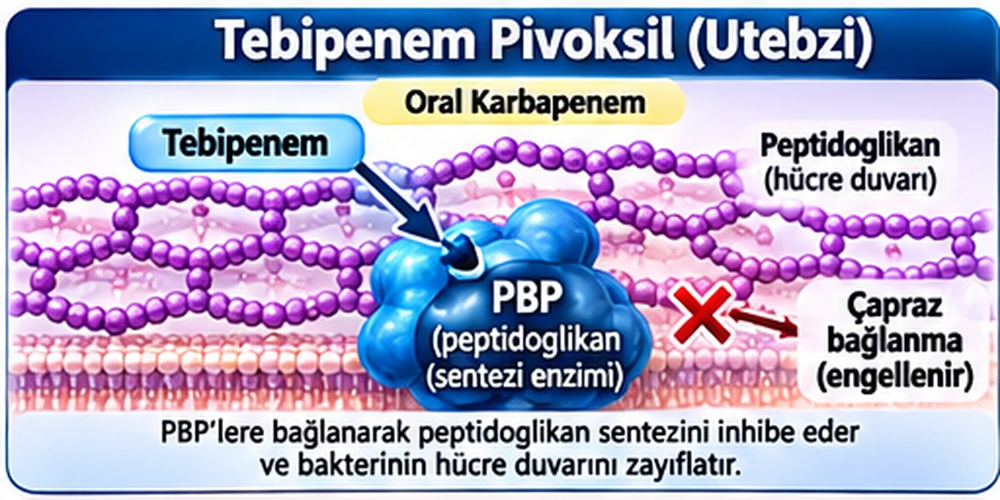

<b>Şekil 8.</b> Tebipenem: PBP'lere bağlanarak peptidoglikan çapraz bağlanmasını engeller (kavramsal şema).

<b>Endikasyon:</b> Ağızdan alınabilecek başka seçeneği sınırlı ya da hiç olmayan erişkinlerde, duyarlı etkenlerin neden olduğu piyelonefrit dahil komplike idrar yolu enfeksiyonları. ABD'de onaylanan ilk oral karbapenemdir.

<b>Klinik kanıt:</b> PIVOT-PO (NCT06059846) randomize, çift kör, çift plasebolu faz III çalışmasında 1.690 hastanede yatan hasta, tebipenem 600 mg ağızdan ya da imipenem–silastatin 500 mg intravenöz (her ikisi 6 saatte bir, 7–10 gün) aldı. Test-of-cure ziyaretinde birincil sonlanım olan genel yanıt %58,5 (261/446) ve %60,2 (291/483) bulundu; düzeltilmiş fark −%1,3 (%95 GA −7,5 ila 4,8). Klinik kür %93,5'e karşı %95,2. Sonuç aşağı kalmamadır; ağır bakteriyemi veya pnömonide üstünlük kanıtı değildir.

<b>Farmakokinetik:</b> 600 mg tek doz sonrasında aktif tebipenem için Cmax 5,0 µg/mL, AUC0–24 64,5 µg·saat/mL, Tmax 0,6–1,5 saat, yarılanma ömrü 1,6 saat, proteine bağlanma yaklaşık %42; idrarda değişmemiş ilaç yaklaşık %62. Farmakodinamik indeks fAUC24/MIC'tir.

<b>Güvenlilik:</b> İshal %8 (68/843), baş ağrısı %3, bulantı %1, karın ağrısı %1, karaciğer enzim yüksekliği %1, C. difficile enfeksiyonu %1; advers olay nedeniyle tedaviyi bırakma %0,6. Pivalat kaynaklı karnitin azalması nedeniyle karnitin eksikliği olanlarda kontrendikedir; nöbet riski ve valproat etkileşimi dikkate alınmalıdır.

<b>Yorum:</b> Erken taburculuğa ve hastane dışı tedaviye olanak sağlayabilir. Öte yandan geniş kullanımı, karbapenem direncini toplumsal düzeye taşıma riski taşır; akılcı antibiyotik politikası açısından sıkı biçimde sınırlandırılması gereken bir ilaçtır.

9. Sulopenem etzadroksil–probenesid (Orlynvah)

FDA onayı: Ekim 2024 · Oral · Penem + böbrek tübüler sekresyon inhibitörü

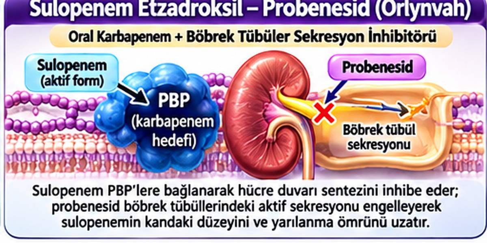

<b>Şekil 9.</b> Sulopenem–probenesid: probenesid tübüler sekresyonu engelleyerek sulopenem düzeyini artırır (kavramsal şema).

<b>Endikasyon:</b> Başka oral seçeneği sınırlı ya da hiç olmayan erişkin kadınlarda E. coli, K. pneumoniae veya P. mirabilis kaynaklı komplike olmayan idrar yolu enfeksiyonu. Komplike idrar yolu enfeksiyonunda ve intravenöz tedavi sonrası ardışık tedavide endike değildir.

<b>Klinik kanıt:</b> FDA, 2021'de ilk başvuruyu ek çalışma gerekçesiyle reddetti. Yeni yapılan REASSURE çalışmasında (yaklaşık 2.200 kadın) amoksisilin–klavulanata duyarlı popülasyonda genel yanıt %61,7'ye karşı %55,0 bulundu; aşağı kalmama ve istatistiksel üstünlük gösterildi. Daha önceki SURE-1 çalışmasında siprofloksasine dirençli izolatlarda üstünlük görüldü. Buna karşılık siprofloksasine duyarlı popülasyonda (mMITT-S; mikrobiyolojik olarak değerlendirilebilen 1.071 hastanın %72,6'sı, 778 hasta) 12. gündeki genel yanıt sulopenemle %66,8, siprofloksasinle %78,6 bulundu; fark −%11,8 (%95 GA −18,0 ila −5,6) ile %10'luk aşağı kalmama sınırı karşılanamadı. Klinik iyileşme oranları benzerdi; farkı, sulopenem kolunda tedavi sonrasında daha sık görülen asemptomatik bakteriüri oluşturdu.

<b>Doz ve güvenlilik:</b> Bir tablet (500 mg sulopenem etzadroksil + 500 mg probenesid) günde iki kez, yemekle, 5 gün. Probenesid kaynaklı ilaç etkileşimleri ve böbrek işlevi dikkate alınmalıdır.

<b>Yorum:</b> Basit sistit için bir penem kullanmak, direnç baskısı açısından ciddi bir bedel taşır. Yalnızca diğer oral seçeneklerin tükendiği olgularda yeri olmalıdır.

10. Pivmesilinam (Pivya)

FDA onayı: 24 Nisan 2024 · Oral · PBP2'ye seçici aminopenisilin ön ilacı

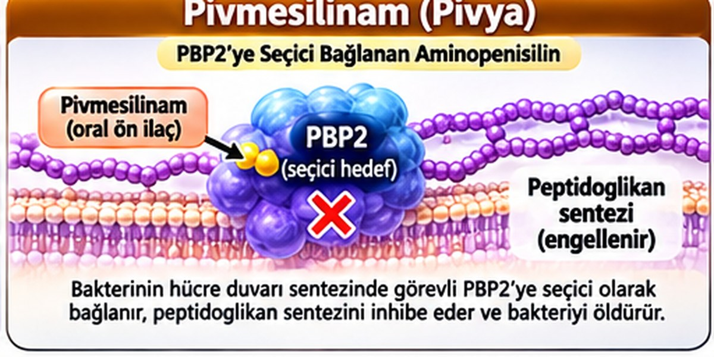

<b>Şekil 10.</b> Pivmesilinam: aktif metaboliti mesilinam PBP2'ye seçici olarak bağlanır (kavramsal şema).

<b>Endikasyon:</b> Erişkin kadınlarda duyarlı E. coli, P. mirabilis ve S. saprophyticus kaynaklı komplike olmayan idrar yolu enfeksiyonu.

<b>Mekanizma ve farkı:</b> Diğer beta-laktamların çoğundan farklı olarak PBP2'ye seçici bağlanır. İskandinav ülkelerinde 40 yılı aşkın süredir ilk seçenek olarak kullanılır; dünya için yeni bir keşif değil, ABD için yeni bir ruhsattır.

<b>Klinik kanıt:</b> Onay, eski üç kontrollü çalışmanın güncel FDA ölçütlerine göre yeniden analizine dayanır. Birleşik yanıt plaseboya karşı %62 (n=137) ve %10 (n=134); başka bir oral antibakteriyele karşı %72 (n=127) ve %76 (n=132); ibuprofene karşı %66 (n=105) ve %22 (n=119).

<b>Doz ve güvenlilik:</b> 185 mg günde üç kez, 3–7 gün. En sık yan etkiler bulantı ve ishaldir. Pivalat kaynaklı karnitin azalması nedeniyle karnitin eksikliği ve bazı metabolik hastalıklarda kullanılmaz.

<b>Yorum:</b> Eski, dar spektrumlu ve direnç profili iyi bilinen bir ilacın ABD'ye girişi akılcı ilaç kullanımı açısından olumludur. Ancak bu bir “yeni antibiyotik” değildir.

D. Araştırma aşamasındaki adaylar

11. Zosurabalpin (RG6006)

Durum: Faz III · Ruhsatsız · Bağlı makrosiklik peptit

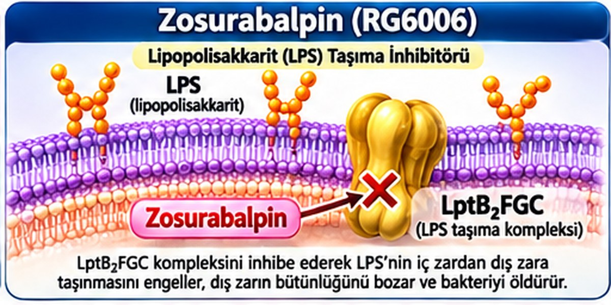

<b>Şekil 11.</b> Zosurabalpin: LptB2FGC kompleksini inhibe ederek LPS'nin dış zara taşınmasını engeller (kavramsal şema).

<b>Hedef ve mekanizma:</b> Gram-negatif bakterinin dış zarını oluşturan lipopolisakkaritin (LPS) iç zardan dış zara taşınmasını sağlayan LptB2FGC kompleksini inhibe eder. Bu, klinikte kullanılan hiçbir antibiyotiğin hedeflemediği yeni bir mekanizmadır ve beta-laktamlardan tamamen farklıdır. Spektrumu Acinetobacter baumannii ile sınırlıdır.

<b>Kanıt düzeyi:</b> Roche ve Harvard araştırmacılarının 2024'te Nature'da yayımlanan çalışmasında karbapenem dirençli A. baumannii izolatlarına ve farelerde akciğer ve uyluk enfeksiyonu modellerine karşı güçlü etkinlik gösterildi. Faz I çalışmaları güvenlilik ve farmakokinetik açısından gelişimi destekledi. Roche, invaziv karbapenem dirençli A. baumannii enfeksiyonu olan yaklaşık 400 hastada faz III çalışma başlatma kararını 2025'te açıkladı.

<b>Klinik durum:</b> İnsanda etkinlik henüz gösterilmemiştir; onaylı endikasyonu ve rutin kullanım dozu yoktur. İnsan advers olay sıklıkları yayımlanmamıştır.

12. Manikomisin

Durum: Preklinik · Ruhsatsız · Doğal depsipeptit

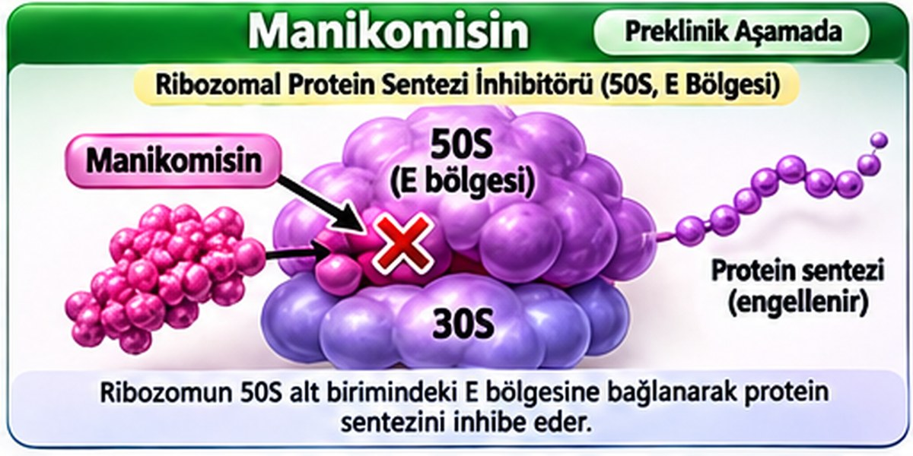

<b>Şekil 12.</b> Manikomisin: ribozomun büyük alt birimindeki E bölgesine bağlanarak protein sentezini durdurur (kavramsal şema).

<b>Hedef ve mekanizma:</b> Streptomyces rimosus'tan elde edilen bir depsipeptittir. Ribozomun 50S alt birimindeki E (çıkış) bölgesine bağlanarak tRNA'nın bu bölgeye girişini engeller ve translokasyon basamağını durdurur. Bugüne kadar bu bölgeyi hedefleyen başka bir antibakteriyel bilinmemektedir.

<b>Kanıt düzeyi:</b> McMaster, Illinois Chicago ve Hamburg üniversitelerinden araştırmacıların Haziran 2026'da Nature'da yayımladığı çalışmada, çok ilaca dirençli Enterobacterales dahil Gram-negatif bakterilere karşı laboratuvar aktivitesi gösterildi.

<b>Klinik durum:</b> İnsanda klinik çalışma yapılmamıştır. Araştırmacılar molekülün henüz klinik kullanıma hazır olmadığını, sistemik maruziyetin ve stabilitenin iyileştirilmesi gerektiğini belirtmektedir. Doz, insan güvenliliği ve klinik kullanım bilinmemektedir.

13. Pre-metilenomisin C lakton

Durum: Preklinik · Ruhsatsız · Doğal ürün biyosentez ara maddesi

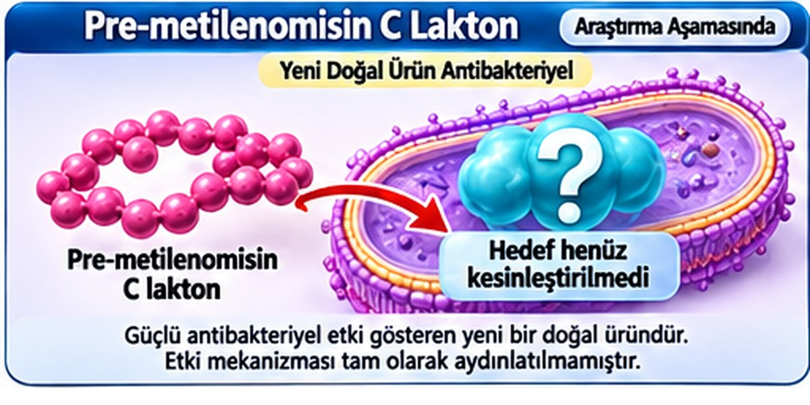

<b>Şekil 13.</b> Pre-metilenomisin C lakton: kesin moleküler hedefi henüz gösterilmemiştir (kavramsal şema).

<b>Köken:</b> Streptomyces coelicolor'un ürettiği metilenomisin A antibiyotiğinin biyosentez yolundaki bir ara maddedir. Warwick ve Monash üniversitelerinden araştırmacılar 2025'te Journal of the American Chemical Society'de yayımladı.

<b>Kanıt düzeyi:</b> Laboratuvarda MRSA'dan sorumlu S. aureus ve VRE'den sorumlu E. faecium dahil çeşitli Gram-pozitif bakterilere karşı metilenomisin A'dan 100 kattan fazla etkili bulundu. Deney koşullarında direnç gelişimi saptanmadı.

<b>Klinik durum:</b> Kesin moleküler hedefi gösterilmediği için hücre duvarı inhibitörü gibi kesin bir sınıfa konması doğru değildir. Bir sonraki adım preklinik testlerdir; insan dozu, farmakokinetik ve güvenlilik verisi yoktur. Ana moleküle göre yüksek aktivite, klinikte kullanılan antibiyotiklerden üstünlük anlamına gelmez.

Karşılaştırmalı değerlendirme

<b>Yeni hedefe yönelenler.</b> Zosurabalpin (LPS taşıma kompleksi) ve manikomisin (ribozom E bölgesi) gerçekten yeni bakteriyel işlevleri hedefliyor; ancak ikisi de ruhsatsız. Pre-metilenomisin C laktonun hedefi ise henüz bilinmiyor.

<b>Yeni sınıf olup klinikte kullanılanlar.</b> Gepotidasin ve zoliflodasin, florokinolonlarla aynı enzimleri farklı kimyasal sınıflarla ve farklı bağlanma bölgelerinden inhibe ediyor. Klinik başarıları ruhsatlı endikasyonlarla sınırlı.

<b>Mevcut sınıfları güçlendirenler.</b> Sefepim–zidebaktam, sulbaktam–durlobaktam, sefepim–enmetazobaktam ve aztreonam–avibaktam farklı enzim ve PBP stratejileri kullanıyor. Seçimde belirleyici olan, karbapenemaz türü ve duyarlılık testidir. Seftobiprol ise Avrupa'da zaten bilinen bir molekülün ABD ruhsatıdır.

<b>Uygulama yenilikleri.</b> Tebipenem pivoksil ve sulopenem–probenesid oral tedavi alanını genişletiyor; ancak ağızdan alınabilmeleri, ağır invazif enfeksiyonda parenteral tedaviye eşdeğer oldukları anlamına gelmez. Pivmesilinam ise eski bir ilacın ABD'deki ilk ruhsatıdır.

Sonuç olarak, son üç yılın “yeni antibiyotikleri” arasında hastada kullanılabilen gerçek anlamda yeni hedefli bir molekül yok. Klinikteki yenilikler değerli ama dar endikasyonlu; çoğu idrar yolu enfeksiyonunda aşağı kalmama çalışmalarıyla ruhsat almış durumda. Yeni hedefli adaylar ise ya faz III'te ya da henüz laboratuvarda.

Bu tablo bize iki şey söylüyor. Birincisi, her yeni onayı “süper bakteriye çare” diye sunmak bilimsel olarak yanlıştır. İkincisi, elimizdeki az sayıdaki yeni seçeneği korumanın tek yolu akılcı antibiyotik kullanımıdır. Özellikle oral karbapenem ve penemlerin basit enfeksiyonlarda gelişigüzel kullanılması, onları birkaç yıl içinde etkisiz kılabilir.

Kaynaklar

<ol style="margin:0 0 6px; padding-left:24px; font-size:9.5pt; line-height:1.3">
	<li style="margin:0 0 1px; padding:0; font-family:Georgia,serif; font-size:9.5pt; line-height:1.3; font-style:italic; color:#333; overflow-wrap:anywhere">FDA. Novel Drug Approvals for 2024, 2025 and 2026. https://www.fda.gov/drugs/novel-drug-approvals-fda</li>
	<li style="margin:0 0 1px; padding:0; font-family:Georgia,serif; font-size:9.5pt; line-height:1.3; font-style:italic; color:#333; overflow-wrap:anywhere">FDA. FDA approves first oral carbapenem therapy for complicated urinary tract infections (Utebzi). 17 Haziran 2026.</li>
	<li style="margin:0 0 1px; padding:0; font-family:Georgia,serif; font-size:9.5pt; line-height:1.3; font-style:italic; color:#333; overflow-wrap:anywhere">Utebzi (tebipenem pivoxil) ABD ürün bilgisi. DailyMed, Haziran 2026. https://dailymed.nlm.nih.gov/dailymed/drugInfo.cfm?setid=f0511453-5f6f-4e3a-b7d0-a5cfde985656</li>
	<li style="margin:0 0 1px; padding:0; font-family:Georgia,serif; font-size:9.5pt; line-height:1.3; font-style:italic; color:#333; overflow-wrap:anywhere">Spero Therapeutics. PIVOT-PO phase 3 data show tebipenem HBr's potential as the first oral carbapenem. 21 Ekim 2025.</li>
	<li style="margin:0 0 1px; padding:0; font-family:Georgia,serif; font-size:9.5pt; line-height:1.3; font-style:italic; color:#333; overflow-wrap:anywhere">Zaynich (cefepime and zidebactam) FDA onay yazısı ve ürün bilgisi, NDA 220787, 2026. https://dailymed.nlm.nih.gov/dailymed/drugInfo.cfm?setid=c84e652e-5e76-4568-8812-bd5fa34803b6</li>
	<li style="margin:0 0 1px; padding:0; font-family:Georgia,serif; font-size:9.5pt; line-height:1.3; font-style:italic; color:#333; overflow-wrap:anywhere">FDA. Zaynich entegre inceleme raporu, 2026. https://www.accessdata.fda.gov/drugsatfda_docs/nda/2026/220787Orig1s000IntegratedR.pdf</li>
	<li style="margin:0 0 1px; padding:0; font-family:Georgia,serif; font-size:9.5pt; line-height:1.3; font-style:italic; color:#333; overflow-wrap:anywhere">Wockhardt. ENHANCE-1 phase 3 results; ZAYNICH FDA approval press release. Haziran 2026.</li>
	<li style="margin:0 0 1px; padding:0; font-family:Georgia,serif; font-size:9.5pt; line-height:1.3; font-style:italic; color:#333; overflow-wrap:anywhere">FDA. Drug Trials Snapshots: BLUJEPA. https://www.fda.gov/drugs/drug-approvals-and-databases/drug-trials-snapshots-blujepa</li>
	<li style="margin:0 0 1px; padding:0; font-family:Georgia,serif; font-size:9.5pt; line-height:1.3; font-style:italic; color:#333; overflow-wrap:anywhere">FDA. Drug Trials Snapshots: NUZOLVENCE. https://www.fda.gov/drugs/drug-approvals-and-databases/drug-trials-snapshot-nuzolvence</li>
	<li style="margin:0 0 1px; padding:0; font-family:Georgia,serif; font-size:9.5pt; line-height:1.3; font-style:italic; color:#333; overflow-wrap:anywhere">Kaye KS, Shorr AF, Wunderink RG, et al. Efficacy and safety of sulbactam–durlobactam versus colistin (ATTACK). Lancet Infect Dis. 2023;23:1072–1084.</li>
	<li style="margin:0 0 1px; padding:0; font-family:Georgia,serif; font-size:9.5pt; line-height:1.3; font-style:italic; color:#333; overflow-wrap:anywhere">Miller AA, et al. Characterization of ABC isolates and microbiological outcome in ATTACK. Antimicrob Agents Chemother. 2024. doi:10.1128/aac.01698-23</li>
	<li style="margin:0 0 1px; padding:0; font-family:Georgia,serif; font-size:9.5pt; line-height:1.3; font-style:italic; color:#333; overflow-wrap:anywhere">Holland TL, Cosgrove SE, Doernberg SB, et al. Ceftobiprole for treatment of complicated Staphylococcus aureus bacteremia (ERADICATE). N Engl J Med. 2023;389:1390–1401.</li>
	<li style="margin:0 0 1px; padding:0; font-family:Georgia,serif; font-size:9.5pt; line-height:1.3; font-style:italic; color:#333; overflow-wrap:anywhere">Kaye KS, Belley A, Barth P, et al. Effect of cefepime/enmetazobactam vs piperacillin/tazobactam (ALLIUM). JAMA. 2022;328:1304–1314.</li>
	<li style="margin:0 0 1px; padding:0; font-family:Georgia,serif; font-size:9.5pt; line-height:1.3; font-style:italic; color:#333; overflow-wrap:anywhere">AbbVie. U.S. FDA approves EMBLAVEO (aztreonam and avibactam). 7 Şubat 2025; Carmeli Y, et al. REVISIT. Lancet Infect Dis. 2025.</li>
	<li style="margin:0 0 1px; padding:0; font-family:Georgia,serif; font-size:9.5pt; line-height:1.3; font-style:italic; color:#333; overflow-wrap:anywhere">Iterum Therapeutics. Orlynvah ürün bilgisi; REASSURE faz III sonuçları. NEJM Evidence. 2025.</li>
	<li style="margin:0 0 1px; padding:0; font-family:Georgia,serif; font-size:9.5pt; line-height:1.3; font-style:italic; color:#333; overflow-wrap:anywhere">Dunne MW, Aronin SI, Das AF, et al. Sulopenem or ciprofloxacin for the treatment of uncomplicated urinary tract infections in women: a phase 3, randomized trial (SURE-1). Clin Infect Dis. 2023;76:66–73. https://pmc.ncbi.nlm.nih.gov/articles/PMC9825825/</li>
	<li style="margin:0 0 1px; padding:0; font-family:Georgia,serif; font-size:9.5pt; line-height:1.3; font-style:italic; color:#333; overflow-wrap:anywhere">FDA. FDA approves new treatment for uncomplicated urinary tract infections (Pivya). 24 Nisan 2024.</li>
	<li style="margin:0 0 1px; padding:0; font-family:Georgia,serif; font-size:9.5pt; line-height:1.3; font-style:italic; color:#333; overflow-wrap:anywhere">Zampaloni C, et al. A novel antibiotic class targeting the lipopolysaccharide transporter. Nature. 2024;625:566–571.</li>
	<li style="margin:0 0 1px; padding:0; font-family:Georgia,serif; font-size:9.5pt; line-height:1.3; font-style:italic; color:#333; overflow-wrap:anywhere">Roche. Zosurabalpin faz III kararı, basın açıklaması, Mayıs 2025.</li>
	<li style="margin:0 0 1px; padding:0; font-family:Georgia,serif; font-size:9.5pt; line-height:1.3; font-style:italic; color:#333; overflow-wrap:anywhere">Kaur M, Travin DY, et al. A natural depsipeptide antibiotic binds the E-site of the bacterial ribosome. Nature. 2026. https://www.nature.com/articles/s41586-026-10589-2</li>
	<li style="margin:0 0 1px; padding:0; font-family:Georgia,serif; font-size:9.5pt; line-height:1.3; font-style:italic; color:#333; overflow-wrap:anywhere">Corre C, et al. Discovery of late intermediates in methylenomycin biosynthesis active against drug-resistant Gram-positive bacterial pathogens. J Am Chem Soc. 2025. doi:10.1021/jacs.5c12501</li>
</ol>

Not: Bu metin eğitim ve bilimsel değerlendirme amaçlıdır; tedavi kararları güncel ürün bilgisi ve yerel duyarlılık verilerine göre verilmelidir. Bu yazının hazırlanmasında AI desteği alınmıştır.

